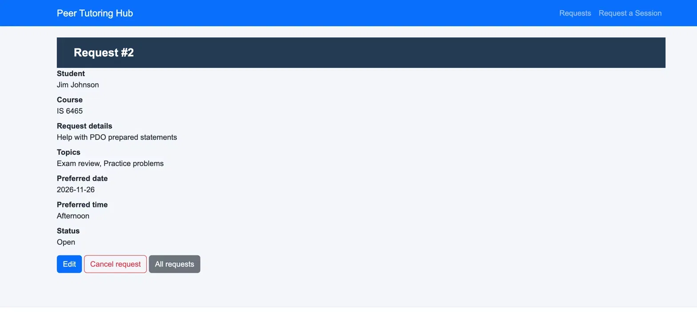

# Lab 6: PHP, PDO, and SQLite Integration

**Student:** Josh Stott
**GitHub repository:** https://github.com/joshstott24-beep/lab6

### Note on the starter code

When I first ran the integration tests, 3 checks failed. The test script builds a temporary in-memory database from `setup-database.sql`, and that script also inserts a sample student and request. The tests count rows as if the database starts empty, so the extra sample rows made three counts off by one. I added one line after the schema is loaded so the tests start with empty tables:

```php
$pdo->exec("DELETE FROM tutoring_requests");$pdo->exec("DELETE FROM students");
```

This only affects the temporary test database, not `tutoring.db`. I did not change any test assertions or application files.

---

## Part 1: Set Up the Database

**Command used (from the `lab6` folder):**

```bash
sqlite3 database/tutoring.db < database/setup-database.sql
```

I then opened the database with `sqlite3 database/tutoring.db`, ran `.tables`, and exited with `.quit`.

**Result:**

```
sqlite> .tables
students     tutoring_requests
sqlite> .quit
```

Both tables, `students` and `tutoring_requests`, appeared, so the database was created successfully.

---

## Part 2: Run the Application

**Command:** `php -S 0.0.0.0:8000`

**URL I opened:** https://cuddly-succotash-v67qv44g6g65cpvqp-8000.app.github.dev/

The root URL redirected to the tutoring request form (`php/request-form.php`).

**Confirmation:** I submitted a test request for "Jim Johnson" in IS 6465 (topics Exam review and Practice problems, 2026-11-26, Afternoon). The app redirected to the detail page for Request #2, which showed all of my values with status Open, so the request was saved to the database and displayed.

**Screenshot of the request detail page:**



---

## Part 3: Test the Application Workflows

| Test | What I Did | Expected Result | Actual Result | Pass or Fail |
|---|---|---|---|---|
| Submit a valid request | Filled out the form with test data (Jim Johnson, IS 6465, 2026-11-26, Afternoon) and submitted it. | A new tutoring request is created with status Open. | Redirected to Request #2 showing my values and status Open. | Pass |
| View all requests | Clicked **Requests** in the navigation bar. | The new request appears in the request list. | The list showed #2 Jim Johnson (my request) and #1 Maria Lopez (the setup sample), both Open. | Pass |
| Filter requests | Filtered by IS 6465 + Open, then by IS 6570. | Filtering by course or status shows matching requests. | IS 6465 + Open showed both matching requests; IS 6570 showed "No matching requests." | Pass |
| Edit an Open request | Submitted a second request (#3, IS 6495), clicked **Edit**, changed the description to "Help with SQL JOIN queries and filters" and the time to Evening, and saved. | The revised values are displayed. | Request #3 showed the new description and Evening, and the status stayed Open. | Pass |
| Cancel an Open request | On Request #2, clicked **Cancel request** and confirmed. | The request status changes to Cancelled. | Request #2 showed status Cancelled, the Edit and Cancel buttons disappeared, and the list showed #2 as Cancelled (the row was kept, not deleted). | Pass |
| Try to edit or cancel a cancelled request | Checked cancelled Request #2 for Edit/Cancel buttons, then opened `edit-request.php?request_id=2` and `delete-request.php?request_id=2` directly by URL. | The application does not allow the change. | No Edit/Cancel buttons were shown. The edit page said "Only Open requests may be edited." with no form, and the cancel page said "Only Open requests can be cancelled." with no confirm button. | Pass |

---

## Part 4: Trace the Request Submission Workflow

1. **Which file displays the tutoring request form?**
   `php/request-form.php`

2. **Which file receives the submitted form data?**
   `php/process-request.php`. It receives the POST and passes the data to the service.

3. **Which file opens the PDO connection to SQLite?**
   `config/db.php`. Its `openDatabase()` function connects to `database/tutoring.db` and turns on foreign key enforcement.

4. **Which file coordinates validation and the database transaction?**
   `services/requestService.php`. The `submitRequest()` function validates the input, then saves the student and the request in one transaction.

5. **Which files contain the SQL statements?**
   `repositories/studentPDO.php` (student SQL) and `repositories/requestPDO.php` (request SQL, including the JOIN queries).

6. **Which table stores student information?**
   `students`

7. **Which table stores tutoring requests?**
   `tutoring_requests`

8. **How does a tutoring request connect to the student who submitted it?**
   Through `student_id`. It is the primary key in `students` and a foreign key in `tutoring_requests`, so each request points to one student, and one student can have many requests.

**Why SQL belongs in repository files:**
Keeping SQL in the repository files follows separation of concerns: the form page only displays HTML, the service handles validation and business rules, and the repositories handle database access. This makes the code easier to read, test, and change. For example, the same `findRequest()` function is reused by the details, edit, and cancel pages. It also keeps all of the prepared statements in one place instead of mixing SQL into the presentation pages.

---

## Part 5: Run the Integration Tests

**Command:** `php tests/integration-tests.php`

**Output:**

```
PASS UC01 create and Open
PASS Lab 4 checkbox values preserved
PASS Duplicate email reuses student
PASS UC02 course and status filter
PASS Invalid reason rejected
PASS Invalid submission writes nothing
PASS Edit Open request
PASS Updated reason persisted
PASS Cancel Open request
PASS Cancelled row retained
PASS Second cancellation rejected
PASS Unrelated request unchanged
PASS FK enforced
PASS UC02 empty filter result
All integration checks passed
```

All 14 checks passed.

---

## Part 6: AI Skills Pack Process

AI tool used: Claude, with the project files provided.

### 1. Application Builder

**Prompt:**
> Explain how a tutoring request moves from php/request-form.php through PHP, PDO, and SQLite in this project. Identify the responsibility of each file.

**AI response:**
> 1. `php/request-form.php` (presentation) shows the form and POSTs it to `process-request.php`.
> 2. `php/process-request.php` receives the POST, opens the database with `openDatabase()` from `config/db.php`, and calls `submitRequest()` in the service.
> 3. `config/db.php` creates the PDO connection to `tutoring.db` and enables foreign keys.
> 4. `services/requestService.php` validates the input (using `includes/validation.php` for the Lab 4 rules). It then starts a transaction, finds or creates the student, saves the request, and commits. If something fails, it rolls back.
> 5. `repositories/studentPDO.php` inserts the student if the email is new (`INSERT OR IGNORE`) and looks the student up by email. `repositories/requestPDO.php` inserts the request with prepared statements.
> 6. SQLite stores the data in `students` and `tutoring_requests`, linked by `student_id`. New requests get the default status Open.
> 7. After saving, the app redirects to `request-details.php`, which uses a JOIN to show the request with the student's name.

**Evaluation:**
I checked the statement that a repeat email does not create a duplicate student. In `repositories/studentPDO.php`, `insertStudentIfAbsent()` uses `INSERT OR IGNORE INTO students`, and `setup-database.sql` makes `student_email` UNIQUE, so the second insert is skipped. The integration test "Duplicate email reuses student" also confirms this. The rest of the response matched the code: the transaction is in `submitRequest()`, and the Open status comes from the table's DEFAULT value.

### 2. Traceability Auditor

**Prompt:**
> Trace the requirement "a student can submit a tutoring request" through the PHP files, service, repositories, SQLite tables, and integration tests in this project.

**AI response:**
> The form in `request-form.php` posts to `process-request.php`, which calls `submitRequest()` in `services/requestService.php`. The service validates the data and runs a transaction that calls `insertStudentIfAbsent()` and `findStudentByEmail()` in `studentPDO.php`, then `insertTutoringRequest()` in `requestPDO.php`. The data is stored in `students` and `tutoring_requests`, linked by `student_id`. In `tests/integration-tests.php`, "UC01 create and Open" checks that a valid request is saved as Open, "Invalid reason rejected" and "Invalid submission writes nothing" check validation, and "FK enforced" checks the foreign key.

| Requirement | Application Page | Service or Validation | Repository or SQL | Database Table | Test Evidence |
|---|---|---|---|---|---|
| Student submits a tutoring request | `php/request-form.php` → `php/process-request.php` | `services/requestService.php` (`submitRequest()`, `validateSubmission()`); `includes/validation.php` | `repositories/studentPDO.php` (find/insert student); `repositories/requestPDO.php` (`INSERT INTO tutoring_requests`) | `students`, `tutoring_requests` (linked by `student_id`) | `tests/integration-tests.php`: "UC01 create and Open", "Duplicate email reuses student", "Invalid reason rejected", "Invalid submission writes nothing", "FK enforced" |

**Evaluation:**
I checked each column against the project. The function names match the repository files. The foreign key is defined in `setup-database.sql`. Every test name appears in `integration-tests.php`. One thing I noticed is that the integration tests call the service functions directly, so they don't test the form page itself. That part is covered by my browser test in Part 3.

### 3. Test Harness Generator

**Prompt:**
> Suggest one useful test case for the Peer Tutoring Hub application. The test must relate to request creation, filtering, editing, cancellation, validation, or database integrity.

**AI response:**
> **Test: a request with a past preferred date is rejected and not saved.** The service only accepts dates of today or later, but the form's date field does not block past dates, so the server check is what protects the data. Submit an otherwise valid request dated yesterday, then check that it is rejected and that the number of rows in `tutoring_requests` does not change.

**Evaluation:**
- **Already covered?** No. The only invalid-input test in `integration-tests.php` uses a reason that is too short. Nothing tests the date.
- **How I would test it:**
  - *Manually:* submit the form with yesterday's date. The page should show "Choose a valid date today or later." and no new request should appear in the list.
  - *Automated:* copy the existing "Invalid reason rejected" test and change the date instead of the reason. Then check that the row count stays the same.
- **Is it appropriate?** Yes. It tests a real business rule in `requestService.php`, and it covers an input the browser doesn't stop.

### Skills Pack Reflection

The AI helped me quickly see how the files connect, from the form to the service, then the repositories, then the database. That made it easier to trace the request workflow and fill in the traceability table. It also suggested a test I hadn't thought of, for past dates, which the current tests don't cover. However, I still had to check its answers against the actual code, because AI can sound confident while getting file names, function behavior, or test coverage wrong. Only the code and the real test results show what the application actually does.

---

## Part 7: Inspect the Database

I opened the database with `sqlite3 database/tutoring.db`, ran the query below, and exited with `.quit`.

```sql
SELECT
    r.request_id,
    s.student_name,
    s.student_email,
    r.course,
    r.topic,
    r.preferred_date,
    r.preferred_time,
    r.status
FROM tutoring_requests AS r
JOIN students AS s
    ON r.student_id = s.student_id
ORDER BY r.request_id;
```

**Output:**

```
request_id | student_name | student_email           | course  | topic                                                                                   | preferred_date | preferred_time | status
1          | Maria Lopez  | maria.lopez@example.com | IS 6465 | PHP arrays and forms                                                                    | 2026-11-03     | 14:00          | Open
2          | Jim Johnson  | student@email.com       | IS 6465 | {"reason":"Help with PDO prepared statements","topics":["Exam review","Practice problems"]} | 2026-11-26     | Afternoon      | Cancelled
3          | Jim Johnson  | Email@Email.com         | IS 6495 | {"reason":"Help with SQL JOIN queries and filters","topics":["Exam review","Practice problems"]} | 2026-11-18     | Evening        | Open
```

**What the JOIN does:**
The JOIN connects each tutoring request to the student who submitted it by matching `student_id` in both tables. Because `tutoring_requests` stores only the `student_id`, the JOIN is what lets the query show the student's name and email next to each request. This way the student's information is stored once in `students` and doesn't have to be repeated in every request. In my results, requests 2 and 3 both show "Jim Johnson" but with different emails, because I used two different emails, so they are two separate student rows. That's why the tables are linked by `student_id` and not by name.
